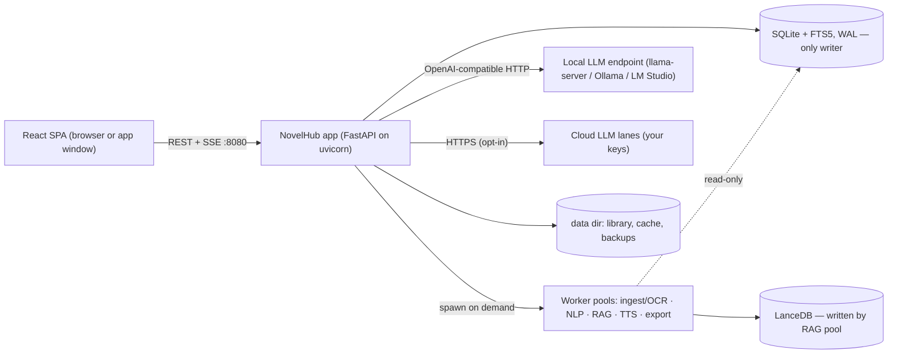

# 00_Master_Overview_and_Connections.md

**Project:** NovelHub — local-first series reader, translator & spoiler-safe AI workspace (open source)
**Document version:** 3.0 (Python-only, contract-first, open-source ready) — 2026-11-03
**Reference development machine:** CachyOS (Hyprland) · Intel i7-13th Gen · 16 GB RAM · RTX 4060 (8 GB VRAM) · Chrome
**Supported platforms:** Linux (primary), Windows and macOS (best effort, CI-tested without GPU), GPU optional
**Status of this file:** the single source of truth for architecture. If a module doc disagrees with this file or with `contracts/`, the module doc is wrong. The full feature catalogue and idea backlog live in `docs/FEATURES_AND_IDEAS.md`.

> Naming: the product is **NovelHub** everywhere (UI, DB file `novelhub.db`, repo, CLI). "SeriesHub AI" and "EPUB-reader" are retired names. Rename the GitHub repo to `novelhub` and check the name is free on GitHub and PyPI before the first release.

---

## 1. What we are building

A web app that runs on your own machine (cloud models are opt-in) to read a series, translate it consistently, and chat with an AI that only knows what you have read.

| # | Feature | Short description | Phase |
|---|---|---|---|
| F1 | Series workspaces | One sidebar thread per series, volumes in canonical (reorderable) order | 1 |
| F2 | File ingest | `.epub`, `.txt`, `.pdf` (selective OCR) through **source adapters**; SHA-256 dedup; auto volume ordering. Web-novel URL import is **not in core**; it can be added later as an adapter plugin (§4.2) | 1, 5 |
| F3 | Paginated reader | Vertical scroll or horizontal flip, editorial page cards, light-novel callout boxes and images | 1 |
| F4 | Sentence-level coordinates | Every sentence is addressable; citations, progress, notes, TTS and search all use the same IDs | 1 |
| F5 | Source peek | Click a translated sentence to see the raw CJK text and the glossary terms used | 2 |
| F6 | Two-tier glossary | Global dictionary + per-series glossary with locked names, entity types, gender pronouns; approval card | 2 |
| F7 | Hybrid translation | Local lane + several opt-in cloud lanes you configure, sliding-window context, glossary injection | 2, 3 |
| F8 | Quality lock | Deterministic audit + targeted Critic repair before a chapter is accepted | 2 |
| F9 | Reader-jump priority | Opening an untranslated chapter moves it to the front of the queue | 2 |
| F10 | Selection actions | Highlight text → Ask AI / Explain scene / Re-translate / Add to glossary / Save as note | 2, 4 |
| F11 | Instant character rename | Rename a character across the whole series in milliseconds | 2 |
| F12 | Spoiler-safe RAG chat | Chat threads per series with citations; the AI only knows what you have read | 4 |
| F13 | Chat memory compaction | Rolling summary per thread | 4 |
| F14 | Text-to-speech | Kokoro (local) and Edge-TTS (optional extra); live sentence highlighting. Custom HTTP engines are a future plugin | 6 |
| F15 | Export | Translated or bilingual `.epub`, `.pdf`, `.txt`; notes export to Markdown | 5 |
| F16 | Global search | `Ctrl+K` across series, volumes, scenes and notes (CJK + English) | 1 |
| F17 | Themes | 4 presets + light customization (accent colour, font, size, line height, content width, paper tone) | 1 |
| F18 | Highlights, notes, bookmarks | Anchored to sentence ranges; colours, tags, search | 1 |
| F19 | **Notes → chat** | Turn selected notes (or a filter such as a volume or tag) into a chat thread; save any assistant answer back as a note | 4 |
| F20 | "Who is this?" card | Tap a character name for a spoiler-safe card: facts you already know, first appearance, relationships | 4 |
| F21 | "Previously on…" recap | A short, spoiler-safe summary up to your position when you reopen a series | 4 |
| F22 | Per-series style guide | Honorific policy, tone, sound-effect handling, custom rules injected into every translation prompt | 2 |
| F23 | Corrections memory | Manual edits become examples that improve later batches | 2, 3 |
| F24 | First-run wizard and `novelhub doctor` | Detect or connect a local LLM endpoint, check optional extras, explain model licenses | 0, 1 |
| F25 | Backup and restore | Export or import a series (data, files, optionally vectors) as one archive | 5 |
| F26 | Install and distribution | PyPI package with bundled UI, extras, CLI, Docker image, docs | 7 |

---

## 2. Non-negotiable design rules

1. **Contract first.** One OpenAPI file plus an events schema in `contracts/`; the TypeScript client is generated from it.
2. **One writer, one language.** One Python application process owns all SQLite writes. Workers never write; they return results to it.
3. **The API process stays light.** Anything expected to take more than about 50 ms of CPU (parsing, OCR, NLP scans, embeddings, reranking, TTS, export, backup) runs in an on-demand worker pool. Heavy libraries are imported only inside workers.
4. **Immutable IDs.** IDs never encode order or layout. Order lives in columns (`volume_order`, `ordinal`).
5. **The database is the truth; events are hints.** Realtime events say "something changed"; the UI re-fetches over REST.
6. **Translate first, index after verify.** RAG never sees raw or unverified text.
7. **One provider per chapter.** A chapter is translated by a single model so names and style stay consistent.
8. **One spoiler function.** The guard is computed in exactly one function and enforced on every retrieval path, including notes and recaps (§7).
9. **Measure before promising.** Every performance number is a *target* until Phase 0 benchmarks replace it.
10. **Local and private by default.** Binds to `127.0.0.1`, requires a token, has no telemetry, and sends book text to a cloud API only if you enable it for that series.
11. **Open-source ready from day one.** No bundled books or models, licenses audited, cross-platform paths, extension points instead of hard-wired sources, and an automatic backup before every schema migration (§14).
12. **Vertical slices.** Each phase (§13) ends in a usable app.

---

## 3. System topology



| Process | Port | Owns | Never does |
|---|---|---|---|
| **NovelHub app** (one worker) | 8080 | HTTP API, SSE, SQLite writes, job loop, routing policy, LLM calls (I/O), static SPA, worker supervision | CPU-heavy work, importing ONNX/OCR/NLP libraries |
| **Worker pools** (child processes, started on demand, exit when idle) | none | Parsing, OCR, NLP scan, embeddings, rerank, TTS synthesis, export and backup building, LanceDB access | Writing SQLite, serving HTTP |
| **Local LLM endpoint** | user-configured (default 8081) | Model weights on the GPU/CPU | — |

The local LLM is **any OpenAI-compatible endpoint**. NovelHub can start and stop `llama-server` for you as a convenience, but you can equally point it at Ollama, LM Studio or vLLM.

---

## 4. Backend stack (lightweight and fast)

| Layer | Choice | Why |
|---|---|---|
| Language | Python 3.12 | One language for API and ML |
| Web framework | **FastAPI** | Pydantic v2 validation and automatic OpenAPI feed the contract-first rule |
| Server | **uvicorn** (`uvicorn[standard]`: `uvloop`, `httptools`), `--workers 1` | Standard, battle-tested ASGI server |
| JSON | `orjson` response class | Fast serialization |
| Database | SQLite (WAL) via `aiosqlite`, plain SQL, numbered migration files | No ORM. One writer connection, a few read-only connections |
| Realtime | `sse-starlette` | Matches the SSE-hints design |
| HTTP client | `httpx` (async, keep-alive) | LLM lanes are I/O waits |
| Job loop | `jobs` table + asyncio worker tasks | Durable; no Redis or Celery |
| Heavy work | `concurrent.futures.ProcessPoolExecutor` per kind, lazy model loading, idle shutdown, spawn-safe | Keeps the GIL and model RAM out of the API process; works on Windows and macOS |
| Vectors | LanceDB | Written by the RAG pool only |
| Paths and secrets | `platformdirs`, `keyring` | Correct data/config locations and key storage on every OS |
| CLI | `typer` (`novelhub start`, `doctor`, `backup`, `restore`, `version`) | One entry point for users and CI |
| Packaging | `hatchling` wheel with the built UI bundled, optional extras | `pip`/`uv tool install` just works (§14) |
| Tooling | `uv`, `ruff`, `pytest`, `mypy` (or `pyright`) | Fast installs and checks |

`--workers 1` is mandatory: the job loop and single-writer rule live in one process.

Considered and not chosen: plain Starlette (FastAPI adds the contract layer at negligible cost), Litestar, Sanic and Quart (smaller ecosystems, no user-visible gain), and a separate hub in another language (extra bridge for no speed gain).

### 4.1 Package layout

```
backend/novelhub/
├── main.py              # app factory, middleware, static SPA, lifespan (pools, jobs, optional llama-server)
├── cli.py               # typer CLI: start, doctor, backup, restore
├── api/                 # routers only: series, volumes, reader, notes, glossary, translate, threads, characters, recap,
│                        #   search, tts, export, backup, settings, system, events
├── core/                # config, db (writer/readers), migrations, ids, auth, events (SSE hub), guard, jobs
├── services/            # library, notes, glossary, translation, rag, chat, recap, tts, export, backup (orchestration; I/O only)
├── providers/           # LLM lanes: generic OpenAI-compatible provider + rate limiter (+ optional native adapters)
├── adapters/            # built-in source, tts and export adapters + the plugin interfaces (§4.2)
├── workers/             # pure functions run in pools: parse, ocr, nlp_scan, embed, rerank, synth, build_export, build_backup
└── gen/                 # generated or exported schemas (events)
```

### 4.2 Extension points (plugins)

Contributors and you can add sources and engines without touching core. Interfaces are defined in Phase 0; plugins are discovered through Python entry-point groups.

| Interface | Entry-point group | Built in | Future / community |
|---|---|---|---|
| `SourceAdapter` → `RawDocument` | `novelhub.sources` | `epub`, `txt`, `pdf` | **Web-novel URL importers** (not shipped in core) |
| `TtsEngine` | `novelhub.tts` | `kokoro`, `edge` (optional extra) | Custom HTTP engines, other local engines |
| LLM lane | settings (config, not code) | Generic `openai_compatible` lane (Gemini, Groq, DeepSeek, OpenRouter, Ollama, LM Studio and vLLM all work through it; add a thin native adapter only if a provider needs one) | Native adapters |
| `Exporter` | `novelhub.export` | `epub`, `pdf`, `txt`, notes `md` | More formats |

```python
class SourceAdapter(Protocol):
    name: str
    def can_handle(self, ref: str | Path) -> bool: ...
    def load(self, ref: str | Path, ctx: AdapterContext) -> RawDocument: ...   # runs in the ingest pool

@dataclass
class RawDocument:
    title: str; language: str; volume_hint: int | None
    chapters: list[RawChapter]          # RawChapter(title, blocks: list[RawBlock(kind, text, image_ref)])
    assets: dict[str, Path]
    snapshot_path: Path                 # the exact bytes fetched or read, kept so re-parsing is reproducible
```

Rules for adapters: network adapters must use `ctx.fetch` (the shared SSRF-safe client, §15) and must write a snapshot file. After an adapter returns a `RawDocument`, the core does the deterministic sentence splitting, so sentence IDs stay stable regardless of source.

---

## 5. Contracts and code generation

```
contracts/
├── openapi.json          # exported from FastAPI by scripts/export_openapi.py (committed)
├── events.schema.json    # JSON Schema exported from the Pydantic event models
└── README.md
```

| Target | Generator | Output |
|---|---|---|
| TypeScript client + types | `openapi-typescript` (+ `openapi-fetch`) | `frontend/src/gen/` |
| SSE event types | `json-schema-to-typescript` | `frontend/src/gen/events.ts` |

CI regenerates both and fails if `git diff` is not empty. Module docs describe implementation; they never redefine a payload.

---

## 6. Identity, coordinates and data model

### 6.1 IDs

| Thing | Format | Example | Notes |
|---|---|---|---|
| Series | `ser_<ulid>` | `ser_01JC…` | Immutable |
| Volume | `vol_<8 base32>` | `vol_8f3a2k9d` | Immutable; **not** the order |
| Chapter | `<volume_id>.c<idx>` | `vol_8f3a2k9d.c014` | `idx` = position in the source |
| Sentence | `<volume_id>.<ordinal 6 digits>` | `vol_8f3a2k9d.004217` | `ordinal` = 1..N within the volume, assigned once at parse time |
| Page card | `(volume_id, page_no)` | — | A *view* over an ordinal range |
| Note / thread / message | `note_<ulid>`, `thr_<ulid>`, `msg_<ulid>` | — | Immutable |

Labels like "Vol 2 • Ch 14 • Page 8" are computed at read time by joining `volumes.volume_order`, `chapters.idx` and `pages.page_no`.

The parser is deterministic and versioned (`parser_version`). A new parser version re-imports as a new volume instead of rewriting IDs in place.

### 6.2 Core tables (sketch; full DDL in `backend/novelhub/core/migrations/`)

```sql
series(series_id PK, title, source_lang, target_lang, cover_path,
       guard_sid, guard_follows_progress, progress_sid,
       style_guide_json, style_guide_rev,
       recap_text, recap_guard_sid,
       cloud_allowed, created_at)

volumes(volume_id PK, series_id FK, volume_order, title, source_adapter, source_ref,
        raw_file_path, snapshot_path, sha256, parser_version, pagination_version,
        total_chapters, total_sentences, total_pages, status, UNIQUE(series_id, sha256))

chapters(chapter_id PK, volume_id FK, idx, title_raw, title_translated,
         ordinal_first, ordinal_last, batch_count, batches_done,
         status, provider, needs_review_count)
         -- status: RAW | QUEUED | DRAFTING | VERIFIED | INDEXED | FAILED

sentences(sid PK, volume_id FK, chapter_idx, ordinal, para_idx,
          block_type,            -- p | h1 | system_box | img
          raw, img_path, batch_idx, UNIQUE(volume_id, ordinal))

translations(id PK, volume_id, sid_first, sid_last, ordinal_first, ordinal_last,
             rev, text_template,  -- contains {{t:<term_id>}} placeholders
             text_rendered,       -- placeholders resolved; feeds FTS and display
             provider,            -- lane name, or 'user' for manual edits
             model, status,       -- draft | verified | flagged
             is_active, created_at)
             -- one row per translation UNIT (usually 1 sentence; n:m groups allowed)

corrections(id PK, series_id FK, sid_first, sid_last, source_text,
            machine_text, user_text, created_at)        -- feeds F23 examples
term_usage(term_id, translation_id)

pages(volume_id, page_no, chapter_idx, ordinal_first, ordinal_last, pagination_version,
      PRIMARY KEY(volume_id, page_no))

global_glossary(term_id PK, source_lang, category, source_term UNIQUE, target_term, notes)
series_glossary(term_id PK, series_id FK, source_term, target_term, entity_type,
                gender_pronoun, sample_context, frequency,
                status,   -- proposed | tentative | approved | rejected
                is_core,
                UNIQUE(series_id, source_term))

notes(note_id PK, series_id FK, volume_id FK, sid_first, sid_last,
      kind,            -- highlight | note | bookmark
      color, body, tags_json, source_msg_id, created_at, updated_at)

chat_threads(thread_id PK, series_id FK, title,
             kind,                     -- general | from_notes
             seed_json,                -- note ids or filter used to create the thread
             rolling_summary, rolling_summary_guard_sid, created_at, updated_at)
chat_messages(msg_id PK, thread_id FK, role, content, citations_json,
              guard_sid_snapshot, created_at)

chapter_summaries(chapter_id PK, text, as_of_ordinal)
character_facts(id PK, series_id, term_id, fact, as_of_ordinal)

jobs(job_id PK, kind, series_id, volume_id, chapter_idx, tier, status,
     attempts, provider, error, requested_at, started_at, finished_at)
     -- kind: ingest | glossary_scan | translate_chapter | index_chapter |
     --       retranslate_units | rerender_term | summarize | recap | export | backup | restore
     -- status: queued | running | done | failed | cancelled

tts_engines(...), user_settings(setting_key PK, value_json, updated_at)
fts_raw    -- FTS5 trigram over sentences.raw
fts_trans  -- FTS5 trigram over translations.text_rendered (active + verified)
fts_notes  -- FTS5 trigram over notes.body
```

SQLite settings: WAL, `synchronous=NORMAL`, `foreign_keys=ON`, `busy_timeout=5000`. Writes go through one connection; reads use a small pool of read-only connections. Queries shorter than 3 characters fall back to `LIKE` because the trigram tokenizer cannot match them (this matters for 2-character CJK names).

### 6.3 Why translations use placeholders

At write time every approved target name (word-boundary match) in the model output is replaced with `{{t:<term_id>}}` in `text_template`, and `text_rendered` is produced from the current glossary.

* **Rename (F11)** = update one `series_glossary.target_term`, then re-render only the rows in `term_usage` and refresh their FTS rows in one transaction. No JSON string replacement, no `Kaelen` → `Kaelenen` corruption.
* A **pronoun/gender change** cannot be fixed by string replacement, so it enqueues a `retranslate_units` job (Tier 2) for just the affected units.
* **Tentative terms** stay safe to change later for the same reason.

### 6.4 Pages are a view

`pages` rows are computed once at ingest (by character budget) and map `page_no` → ordinal range. Font size changes never alter pages. A change in pagination rules bumps `pagination_version` and rebuilds `pages` only; sentence IDs, progress, guard, notes and vectors are unaffected because they use `ordinal`.

---

## 7. Spoiler Guard contract (single implementation)

**Stored state:** `series.guard_sid` (the last sentence the AI may know). `guard_follows_progress` (default on) moves it with reading progress; "Sync AI memory to current page" sets it manually.

**One function** `guard_spec(series) → list[{volume_id, max_ordinal}]`:

* volumes with `volume_order` lower than the guard volume → `max_ordinal = total_sentences`
* the guard volume → `max_ordinal = ordinal(guard_sid)`
* later volumes → omitted

Every context path receives this spec and must apply it:

| Context source | Rule |
|---|---|
| Vector chunks (rows carry `volume_id`, `ordinal_first`, `ordinal_last`) | Keep only chunks with `ordinal_last <= max_ordinal` for their volume |
| BM25 (`fts_trans`) | Same predicate in SQL |
| Parent-scene promotion | Promote only to parents fully inside the range (trim otherwise) |
| Chapter summaries | Eligible only if the whole chapter is inside the range |
| Character facts, character cards, glossary notes | Include only facts with `as_of_ordinal` inside the range |
| **Notes (including notes seeding a chat thread)** | Include only notes whose `sid_last` is inside the range |
| **Recap** | Built only from summaries and notes inside the range; regenerated if `recap_guard_sid` is beyond the current guard |
| Chat history and `rolling_summary` (per thread) | Exclude turns whose `guard_sid_snapshot` is beyond the current guard; if the summary's snapshot is beyond it, regenerate from the remaining turns |
| Selection actions | Same spec, derived from the series, never from the request body |

Chunk text shown to the LLM is fetched from SQLite by ordinal range at query time, so renames apply instantly and LanceDB stores only vectors plus ranges.

**Tests (Phase 4 exit):** a property test over random guard positions asserting no returned ordinal exceeds the range, plus 20 adversarial prompts with zero leaks.

---

## 8. Realtime, jobs and translation

### 8.1 Server-Sent Events

* `GET /api/v1/events` (SSE, `Last-Event-ID` resume) carries small hint events: `job.updated`, `volume.status`, `chapter.status`, `glossary.ready`, `chapter.indexed`, `error`. Payload = IDs + status; the client re-fetches over REST.
* Chat streams directly from `POST /api/v1/threads/{id}/chat` as its own SSE response (token events, then a final `citations` event).
* TTS audio is plain HTTP (§10.4).

### 8.2 Durable job queue (the `jobs` table)

Claim order (executed on the writer connection):

```sql
ORDER BY tier ASC,
         CASE WHEN tier = 1 THEN requested_at END ASC,   -- reader jumps: FIFO
         volume_order ASC, chapter_idx ASC               -- background: canonical order
```

| Tier | Source | Behaviour |
|---|---|---|
| 0 | Selection actions, chat, character cards | Not queued. Synchronous, uses the **reserved interactive LLM slot** |
| 1 | Reader jump (`translate/prioritize`) | Promotes that chapter and the next one |
| 2 | Background volume translation, glossary-driven re-translation, re-render, recap, backup | Canonical order |

Rules: on startup every `running` job returns to `queued`; `volume_order` is joined at claim time so reorder needs no job rewrite; duplicate `(kind, chapter)` jobs are merged; max attempts per job configurable (default 3). Concurrency: one local translation job at a time, plus up to N concurrent jobs per enabled cloud lane.

### 8.3 Translation flow (per chapter, per batch)

1. The job loop claims a `translate_chapter` job and **pins `chapters.provider`** using the routing policy (§9).
2. For each batch (`sentences.batch_idx`, planned at ingest at about 600–800 source tokens), the translation service builds the prompt in-process (§8.5).
3. It calls the pinned lane over async HTTP, parses `[[sid]]`-tagged output, replaces approved target names with placeholders, and runs the audit (cheap regex and set checks, safe in-process).
4. Units are committed as `translations.status = 'draft'`; `batches_done` advances; a `chapter.status` hint is emitted.
5. After the last batch all drafts become `verified` (or `flagged` for units that exhausted the Critic), then an `index_chapter` job is enqueued.
6. A crash resumes from the first missing batch. If the pinned lane must change (rate limit exhausted), that chapter's drafts are discarded and it restarts on the new lane, so a chapter never mixes models.

### 8.4 Audit and Critic

| Rule | Severity | Behaviour |
|---|---|---|
| Coverage: every input `sid` covered exactly once (n:m groups like `[[a-c]]` allowed) | Hard | Fails → Critic |
| Residual CJK outside an allowlist (quoted source terms, SFX, glossary entries that keep source text) | Hard | Fails → Critic |
| Approved term present in source but its target missing | Soft | Logged; fails only if no pronoun or elision is plausible (sampled review) |
| Critic attempts | — | Max 2 per unit, then `flagged` with a review badge. Never loops forever |

Per-rule failure rates are stored in `audit_stats` so the audit itself can be tuned.

### 8.5 Prompt budget (validate in Phase 0)

Every local request must fit a 4K-token slot. Planned worst case:

| Part | Budget (tokens) |
|---|---|
| System prompt + **style guide** | ≤ 250 |
| Matched glossary terms and pronoun hints | ≤ 300 |
| **Correction examples** (up to 3 relevant past edits) | ≤ 300 |
| Previous-batch source overlap | ≤ 300 |
| Batch source text | ≈ 700 |
| Output | ≈ 800–1,000 |
| **Total** | ≈ 2.9K, leaving margin |

---

## 9. Routing policy and lanes

A **lane** is a configured endpoint: `{name, kind: local|cloud, base_url, api_key (keyring), model, rpm, tpm, concurrency, enabled}`. One generic OpenAI-compatible provider class serves all of them.

| Lane | Role | Notes |
|---|---|---|
| `local` | Default for everything; the only lane for Tier 0 unless cloud is allowed | With llama-server start from `--parallel 2 -c 8192` (4K tokens per slot): one slot for translation, one reserved for interactive use; tuned in Phase 0 |
| Any number of cloud lanes (Gemini, Groq, DeepSeek, OpenRouter, others) | Opt-in speed lanes for Tier 1/2 | You supply the keys and limits; free-tier terms change, so nothing is hard-coded |

* Per-series switch `cloud_allowed` (default **off**). When off, no text from that series leaves the machine.
* When on, background chapters may use any enabled cloud lane that has budget; reader-jump chapters prefer cloud if available, otherwise local.
* The model line-up is a **measured choice**: Phase 0 compares models on the eval set and records the winner in the decision log.

---

## 10. Glossary, style guide, corrections and TTS

### 10.1 Glossary (approval without blocking)

1. **Scan** (`glossary_scan` job, NLP pool): SudachiPy / Jieba / kiwipiepy generate *candidates*, deduped against the global dictionary and existing series terms. One LLM call proposes target names, entity types and pronouns. Analyzers are candidate generators, not a source of truth.
2. **Core set:** the approval card shows terms with `is_core = true` (characters with frequency ≥ 3 plus the top-N other terms by frequency; N configurable, default 60). The user edits, optionally ticks "Save to Global Dictionary", and clicks **Confirm & Start Translation**.
3. **Non-core terms** are stored as `tentative` with the proposed target and used immediately. They surface later in a "new terms found in Ch. N" card. Renames are cheap (§6.3), so a late correction costs milliseconds.
4. Later volumes inherit the series glossary; only new candidates are shown.

### 10.2 Per-series style guide (F22)

`series.style_guide_json` holds a small structured form plus free text, injected into every translation prompt:

| Field | Options |
|---|---|
| Honorifics | keep (`-san`, `-sama`) · translate · localize |
| Tone | literal · natural · casual |
| Sound effects | translate · keep · romanize |
| Dialogue / address notes | free text (≤ 200 tokens in total with the rest) |

Changing the guide bumps `style_guide_rev`. It does **not** silently retranslate; the UI offers "Re-translate affected chapters" as a Tier 2 job.

### 10.3 Corrections memory (F23)

* Editing a translated unit (`PUT /units/{id}`) writes a new `translations` revision with `provider='user'` and a `corrections` row (source text, machine text, your text).
* The prompt builder selects up to 3 relevant corrections for each batch (matching glossary terms or FTS hits on the batch's source) and injects them as examples within the budget in §8.5.
* Manual edits are never overwritten by a later automatic pass unless you explicitly re-translate that unit.

### 10.4 TTS (no server-side ring buffer)

* `GET /api/v1/tts/unit/{translation_id}?engine=&voice=&speed=` returns audio (Opus or WAV) for one translation unit. Synthesis runs in the TTS pool; results are cached in `data/cache/tts` (LRU by size).
* The client prefetches the next 3 units, schedules them gaplessly with the Web Audio API, and highlights the active unit from its own playback clock. Pause or skip = abort the fetches.
* Built-in engines: `kokoro` (local) and `edge` (optional extra; it relies on an unofficial Microsoft endpoint and may break, so it is off by default and documented as such). Custom HTTP engines arrive later through the `TtsEngine` plugin interface.

---

## 11. RAG, chat threads, notes → chat, character cards and recap

### 11.1 Index and query

* **Index** (`index_chapter`, RAG pool): reads the chapter's rendered translation from SQLite (read-only), builds child chunks (~150 tokens) and parent scenes (~800 tokens), embeds the children on CPU, writes to `data/lancedb/<series_id>`, and returns a chapter summary and character facts that the app commits.
* **Query:** guard spec → hybrid retrieval (vector over children + BM25) with RRF → promote to parents → small English cross-encoder rerank of the top 8–10 → rank 1 at the top and rank 2 at the bottom of the context → streamed answer with citations (sentence ID ranges + rendered labels). Embedding and reranking run in the RAG pool; the LLM call is async I/O from the app.
* **Models:** embedding (`bge-small-en-v1.5` or `bge-base-en-v1.5`, ONNX INT8) and reranker (a small English cross-encoder) are chosen in Phase 0 by measured latency and answer quality.
* **Why the RAG pool owns LanceDB:** SQLite stays single-writer; vector data has its own owner.

### 11.2 Chat threads and compaction

A series can have many threads (`chat_threads`). Each thread keeps its own `rolling_summary`, compacted every 10 messages by a `summarize` job, with a `guard_sid` snapshot (§7).

### 11.3 Notes → chat (F19)

1. In the notes panel select notes (multi-select, or a filter by volume, tag or kind) and press **Chat about these notes**.
2. `POST /series/{id}/threads/from-notes` creates a thread with `kind='from_notes'` and `seed_json`. The seed context is the notes' text plus the passages they anchor to (±1 paragraph), all filtered by `guard_spec`.
3. In every later turn the seed notes stay pinned in context (token-capped; if they exceed the cap, the most recent or most relevant are kept and the UI says so), alongside normal guarded retrieval.
4. The user may type a first question or tap a suggestion: "Summarize my notes", "What questions are still open?", "Find connections between these notes".
5. Reverse direction: **Save as note** on any assistant message creates a note (`source_msg_id` set) anchored to the first citation's range, or to the current reading position when there is no citation.
6. Notes export to Markdown (for example for Obsidian) from the notes panel.

### 11.4 "Who is this?" card (F20)

`GET /series/{id}/characters/{term_id}` returns name (target and source), entity type, pronoun, first appearance (link into the reader), and the facts from `character_facts` whose `as_of_ordinal` is inside the guard, each with a citation. Facts are produced during chapter indexing; a Tier 0 call fills gaps only when none exist.

### 11.5 "Previously on…" recap (F21)

`GET /series/{id}/recap` returns the cached `recap_text` when `recap_guard_sid` equals the current guard; otherwise a `recap` job builds a short recap from the last few chapter summaries inside the guard plus your latest notes. The UI offers it when you reopen a series after a break (threshold is a setting) or on demand.

---

## 12. API summary (`/api/v1`, bearer token required)

(The authoritative definition is `contracts/openapi.json`; this is the human index.)

| Area | Endpoints |
|---|---|
| Series | `GET/POST /series`, `GET/PATCH/DELETE /series/{id}`, `GET/PUT /series/{id}/style-guide` |
| Volumes | `POST /series/{id}/volumes` (file upload; returns `job_id`), `PUT /series/{id}/volumes/order`, `GET /volumes/{id}`, `GET /volumes/{id}/toc` |
| Reader | `GET /volumes/{id}/pages?from=&limit=&mode=raw\|translated\|bilingual`, `PUT /series/{id}/progress`, `PUT /series/{id}/spoiler-guard` |
| Notes | `GET /series/{id}/notes?volume=&kind=&tag=&q=`, `POST /series/{id}/notes`, `PATCH/DELETE /notes/{id}`, `GET /series/{id}/notes/export?format=md\|json` |
| Glossary | `POST /volumes/{id}/glossary/scan`, `GET /series/{id}/glossary`, `PUT /series/{id}/glossary` (approve/edit batch), `POST /series/{id}/glossary/promote`, `PATCH /series/{id}/glossary/{term_id}` (rename = edit target) |
| Translation | `POST /volumes/{id}/translate`, `POST /volumes/{id}/translate/prioritize`, `POST /units/{id}/retranslate`, `PUT /units/{id}` (manual edit), `POST /units/{id}/revert` |
| Selection actions | `POST /reader/selection-action` (Tier 0, streams) |
| Chat threads | `GET/POST /series/{id}/threads`, `PATCH/DELETE /threads/{id}`, `GET /threads/{id}/messages`, `POST /threads/{id}/chat` (SSE stream), `POST /series/{id}/threads/from-notes`, `POST /threads/{id}/messages/{msg_id}/save-as-note` |
| Characters & recap | `GET /series/{id}/characters`, `GET /series/{id}/characters/{term_id}`, `GET /series/{id}/recap`, `POST /series/{id}/recap/refresh` |
| Search | `GET /search?q=&series=` |
| TTS | `GET/PUT /tts/engines`, `GET /tts/unit/{translation_id}` |
| Export | `POST /volumes/{id}/export` (returns `job_id`), `GET /exports/{job_id}/file` |
| Backup | `POST /series/{id}/backup` (job), `POST /system/restore` (upload) |
| Jobs & events | `GET /jobs`, `POST /jobs/{id}/cancel`, `GET /events` (SSE) |
| Assets | `GET /assets/{volume_id}/{name}` (content-type allowlist) |
| Settings & system | `GET/PUT /settings` (lanes, theme; secrets write-only, returned masked), `GET /system/status` (used by the wizard and `novelhub doctor`), `GET /health` |

---

## 13. Phased delivery plan

Sizes: S ≈ a few focused days, M ≈ 1–2 weeks, L ≈ 2–4 weeks (part-time pace; recalibrate after Phase 0).

| Phase | Name | Size | Scope | Exit criteria |
|---|---|---|---|---|
| 0 | Foundations, benchmarks and repo hygiene | M | Repo skeleton, FastAPI + uvicorn app, `contracts/` export + TS codegen, worker-pool scaffold, plugin interfaces (`SourceAdapter`, `TtsEngine`, `Exporter`), CLI with a `doctor` stub, **LICENSE chosen, README skeleton, CONTRIBUTING, CI (lint, tests, contract drift, license audit)**, mock LLM server for CI, eval set, benchmark spike (§17.4) | Decision log filled with measured numbers; UI → API → pool "hello" round trip; CI green on Linux |
| 1 | Library, reader and notes (F1–F4, F16–F18, F24 wizard) | L | EPUB/TXT adapters, deterministic parser, pagination, reader (both modes), progress, themes (presets + light customization), highlights/notes/bookmarks, `Ctrl+K` search (incl. 2-character CJK and notes), first-run wizard | 3 test EPUBs import; 1,000-page scroll stays smooth; progress and notes survive restart; search finds 2-char names; wizard connects to a local endpoint |
| 2 | Glossary and local translation (F5–F6, F8–F11, F22–F23) | L | Scan, approval card, job loop, local lane, batch pipeline, audit/Critic, style guide, manual edits and corrections memory, bilingual toggle, source peek, re-translate + revert, rename, SSE | Eval-set translation meets the Phase 0 bar; rename correct on test names; kill/restart mid-chapter resumes without loss; a correction visibly improves a later batch |
| 3 | Multi-lane router (F7) | M | Cloud lanes through the generic OpenAI-compatible provider, per-series `cloud_allowed`, per-chapter pinning, rate-limit handling, lane settings and key storage | Cloud lane faster than local-only on the eval volume; no chapter mixes models; keys never appear in any API response |
| 4 | Spoiler-safe AI (F12–F13, F19–F21) | L | Indexing, summaries/facts, guarded retrieval, rerank, chat threads, **notes → chat**, character cards, recap, citations → jump to reader, compaction | Guard property test + 20 adversarial prompts = 0 leaks (including notes and recap); citation accuracy ≥ the target set in Phase 0; notes → chat works end to end |
| 5 | PDF, export and backup (F2 PDF, F15, F25) | M | PDF adapter + selective OCR, EPUB/PDF/TXT export (translated + bilingual), notes Markdown export, backup/restore | Scanned PDF sample readable; exported EPUB opens in a standard reader; backup → restore round trip on a fresh data dir |
| 6 | TTS (F14) | M | Kokoro and Edge-TTS (optional extra), per-unit endpoint + cache, Web Audio scheduling, highlight, engine modal | Gapless playback across 50 units; skip/pause responds instantly |
| 7 | Packaging and v1.0 release (F26) | M | Wheel with bundled UI, extras, `novelhub` CLI, Docker image, install guides (Linux, Windows, macOS), screenshots with public-domain text, release workflow, SECURITY.md | Fresh machine installs and reaches a working reader in about 10 minutes following the README; `novelhub doctor` green; tagged release published |

Phases 5 and 6 can swap.

**Deferred (design keeps the door open, nothing built yet):** URL / web-novel source adapters, custom HTTP TTS engines, advanced Theme editor with import/export. See `docs/FEATURES_AND_IDEAS.md`.

---

## 14. Open-source release plan

| Area | Plan |
|---|---|
| License | Decide before the first public commit. Apache-2.0 is the recommended default (permissive, patent grant). Choose AGPL-3.0 instead only if you want network-use copyleft |
| Dependency licenses | Audit in CI (`pip-licenses`, `license-checker`). Avoid PyMuPDF (AGPL-3.0) for PDFs unless the project itself is AGPL; prefer `pypdfium2`. Check NLP libraries and dictionaries (Sudachi, Kiwi) before bundling or documenting them |
| Content and models | Nothing is bundled: no books, no model weights. The wizard shows each recommended model's license. Eval fixtures and README screenshots use public-domain text only |
| Disclaimer | README and first-run notice: you are responsible for having the right to the files you import; translations are for personal use; the project does not host or distribute content; no scraping adapters ship in core. (Have the wording reviewed if it matters to you; this plan is not legal advice) |
| Privacy | No telemetry, no accounts, no network calls except endpoints you configure; cloud lanes are opt-in per series. State this in the README |
| Repo files | `README.md` (screenshots, 5-minute quickstart, measured hardware table, FAQ), `LICENSE`, `NOTICE`, `CONTRIBUTING.md`, `CODE_OF_CONDUCT.md`, `SECURITY.md` (private reporting), `CHANGELOG.md`, issue and PR templates, `docs/` (architecture = this file, `FEATURES_AND_IDEAS.md`, plugin guide) |
| CI | GitHub Actions: ruff, mypy/pyright, pytest (Linux full; Windows and macOS run core tests against the mock LLM), frontend lint/test/build, contract drift check, license audit, `pip-audit` and Dependabot, release workflow that builds the wheel with the UI bundled |
| Packaging | One PyPI package with the built UI inside. Extras keep the base install small: `novelhub[ja]`, `[zh]`, `[ko]`, `[ocr]`, `[rag]`, `[kokoro]`, `[edge]`, `[all]`. Install with `uv tool install` or `pipx`. A Docker image and compose file (NVIDIA container toolkit documented) are secondary; an AppImage or installer can come later |
| Local LLM | Bring your own OpenAI-compatible endpoint. The wizard auto-detects common ports (llama-server, Ollama, LM Studio), offers a recommended-model list, and can optionally manage `llama-server` for you |
| Cross-platform | Linux first. `platformdirs` for paths, `keyring` for secrets, spawn-safe worker pools, no desktop-environment-specific code. Windows and macOS stay "best effort" until CI and volunteers confirm them |
| Upgrades and data safety | Forward-only numbered migrations; the app copies the database to `backups/` before applying any migration; semantic versioning; release notes list schema changes; the `parser_version` rule prevents silent ID changes |
| Security posture | Default bind `127.0.0.1`; `--host 0.0.0.0` prints a warning and requires the token; `SECURITY.md` explains reporting |
| Contribution flow | Labels `good first issue`, `help wanted`, `plugin`; a plugin guide for source adapters and TTS engines; GitHub Discussions for questions |
| Name check | Confirm "NovelHub" is available on GitHub and PyPI (and note any similarly named projects) before the first release |

---

## 15. Security and privacy

| Risk | Control |
|---|---|
| Any website calling `localhost:8080` | Bind `127.0.0.1`; random bearer token generated at start and injected into the SPA's `index.html` by the app (cross-origin pages cannot read it); strict `Host`/`Origin` checks (also stops DNS rebinding); no wildcard CORS |
| Local LLM endpoint exposure | Bind `127.0.0.1`; when NovelHub starts llama-server it passes a generated `--api-key` |
| SSRF through any network-fetching adapter or custom engine | One shared fetcher (`ctx.fetch`): resolve DNS and block loopback/private/link-local ranges (also on redirects), size and time limits. Core ships no network source adapter |
| Malicious EPUB/PDF | Zip limits (entry count, expansion ratio), path-traversal checks, HTML reduced to a structured block model (never injected raw into the DOM), SVG disallowed or sanitised, images served from `/assets` with a content-type allowlist |
| Worker crash on a bad file | Parsing runs in a pool process; a crash fails that job without taking down the API |
| API key exposure | Keys in the OS keyring (or environment); write-only in the settings API; masked on read; never included in backups |
| Book text sent to cloud | `cloud_allowed` per series, default off; the README tells users to check each provider's data terms |
| Malicious backup archive | Validate the manifest and schema version, reject path traversal, restore into a staging directory first |

---

## 16. Repository layout

```
novelhub/
├── contracts/            # openapi.json, events.schema.json (committed, CI-checked)
├── docs/                 # this file, FEATURES_AND_IDEAS.md, plugin guide, decisions/ (ADR log)
├── backend/              # Python app (pyproject.toml managed by uv)
├── frontend/             # React SPA
├── eval/                 # public-domain fixtures, golden outputs, questions.yaml, mock LLM server
├── scripts/              # export_openapi.py, codegen.sh, release helpers
├── .github/              # workflows, issue/PR templates, dependabot
├── LICENSE  NOTICE  README.md  CONTRIBUTING.md  CODE_OF_CONDUCT.md  SECURITY.md  CHANGELOG.md
└── data/                 # gitignored runtime data in development (users get a platformdirs location)
```

---

## 17. Quality, testing and Phase 0 benchmarks

### 17.1 Eval set

* 3 public-domain or openly licensed EPUBs (JA, ZH, KO), one with callout boxes or illustrations, plus one scanned PDF
* A few chapters with reference translations for side-by-side checks
* 20 RAG questions with known answers and expected citations
* 20 adversarial spoiler prompts, including notes and recap paths
* A mock LLM server so CI runs without a GPU

Personal books stay out of git.

### 17.2 Metrics and tests

| Area | Metric / test |
|---|---|
| Parser | Golden-file tests: same input → identical `sid`s and pages |
| Translation | Audit pass rate per rule, name-consistency rate against the approved glossary, blind side-by-side vs a cloud reference on 3 chapters |
| Corrections memory | After editing a sentence, a later batch with the same term uses the correction's wording |
| RAG | Answer hit rate and citation accuracy on the 20 questions |
| Spoiler guard | Property test + adversarial set, target 0 leaks |
| Notes → chat | Seed notes appear in context; notes beyond the guard are excluded |
| Jobs | Kill the app mid-chapter; verify resume with no duplicate or lost units |
| Backup | Backup → restore on a fresh data dir yields identical IDs and rendered text |
| Responsiveness | Event-loop lag stays low while OCR, embedding or TTS runs in a pool |
| Contracts | Generated files up to date in CI |

### 17.3 Resource targets (unverified until Phase 0)

| Resource | Target |
|---|---|
| GPU | Qwen3-8B Q4_K_M weights ≈ 5 GB + KV cache ≈ 0.7 GB at 8K context (q8 KV); headroom for compositor and browser |
| App process RAM (idle) | Aim for under ~150 MB with no heavy libraries imported |
| Each worker pool | Loaded on demand, exits after idle timeout; total Python RAM under ~2 GB at peak |
| Browser tab | As low as virtualization allows; measure, don't promise |

Published numbers in the README must name the hardware they were measured on.

### 17.4 Phase 0 benchmark spike

| Question | Measure |
|---|---|
| Local LLM throughput | Tokens/s per slot with 1 and 2 slots at 4K context; VRAM with desktop + browser running (`nvidia-smi`) |
| Is the batch size right? | Source tokens per request that fit a 4K slot with the §8.5 prompt budget |
| API baseline | Requests/s and idle RSS of the real app under uvicorn; SSE with several open streams |
| App process footprint | Idle RSS of the API process; cold-start time of each worker pool |
| Event-loop health | Loop lag while a pool runs OCR/embedding |
| Embedding cost | Seconds to embed one real chapter with each candidate model |
| Rerank cost | Latency for 8, 10 and 20 candidates with each candidate reranker |
| Translation quality | Candidate local and cloud models on the 3-chapter reference set |
| Pre-scan | Real runtime and candidate quality of Sudachi/Jieba/Kiwi on a full volume |
| Reader performance | Variable-height virtualization with a 1,000-page book; browser tab memory |
| Whole-volume time | Local-only vs local + cloud for one volume |
| Endpoint detection | Wizard finds llama-server, Ollama and LM Studio on default ports |

---

## 18. Decision log (initial)

| Decision | Why | Revisit if |
|---|---|---|
| Python only (no separate hub) | Heavy work is already native code; one language removes bridges and duplicate contracts | A multi-user server is ever needed |
| FastAPI + uvicorn, one worker | OpenAPI/Pydantic for contracts; mature ASGI stack; single writer and job loop in one process | Profiling shows the HTTP layer is a bottleneck (very unlikely) |
| Process pools instead of microservices | In-process function calls, crash isolation, idle shutdown | Pool IPC overhead shows up in profiles |
| SQLite WAL, single writer | Simple, fast, no lock contention | Multi-user or cloud deployment (add `user_id` and object storage; today the app is single-user) |
| SSE over WebSocket | All traffic is server → client; native resume; less code | A true bidirectional need appears |
| Jobs table over in-memory heap | Survives restarts, free retries, no comparator bug | Throughput outgrows SQLite (very unlikely) |
| Placeholders in translations | Cheap rename, no string corruption | Rendering cost becomes visible |
| LanceDB for vectors | Keeps the RAG pool as sole owner of vector data | Sync problems; evaluate `sqlite-vec` |
| Local-first, cloud opt-in, multiple lanes | Privacy, cost, consistency, and you already use several models | Phase 0 shows local quality is unacceptable |
| One generic OpenAI-compatible provider | Most providers and local runtimes speak it; far less code than a class per provider | A provider needs features it cannot express |
| Bring-your-own local LLM endpoint | Works with llama-server, Ollama, LM Studio; avoids bundling binaries per OS | Support burden shows the app should manage the server |
| Source adapters as plugins; URL import deferred | Legal and maintenance burden of scraping stays out of core; contributors can add sources | Strong demand and a maintainer for a specific site |
| Custom HTTP TTS deferred | Kokoro and Edge-TTS cover nearly all use; interface keeps it addable | Users ask for specific engines |
| Themes: 4 presets + light customization | Covers real needs without a full editor | Users request sharing or deeper control |
| Chat threads (not one chat per series) | Needed for notes → chat and for separate lines of questioning | — |
| Optional extras for heavy dependencies | Small base install; users add only the languages and features they use | Extras complicate support |
| License: Apache-2.0 recommended (pending) | Permissive with a patent grant | You want network-use copyleft (AGPL) |

---

## 19. What changed and what the module docs must absorb

| v1.x behaviour | Now |
|---|---|
| Go hub + Python worker with an internal Bridge B | One Python app; heavy work in on-demand process pools |
| Two contracts and three code generators | One OpenAPI file, TypeScript client only |
| `coord_id = vol_{order}_ch_{n}_pg_{p}_s_{s}` | Immutable `sid = <volume_id>.<ordinal>`; labels derived |
| Spoiler filter `volume_order <= V AND page_num <= P` | Ordinal-based `guard_spec`, applied to every context path (§7) |
| Both Go and Python "own" SQLite | Only the app process writes; pools are read-only |
| In-memory priority heap with mixed comparator | Durable `jobs` table with total ordering |
| `sentences_json` blob, 1:1 raw/translated | `sentences` + `translations`, n:m units, placeholders |
| `REPLACE()` rename on JSON | Re-render via `term_usage` |
| FTS5 trigram only | Trigram plus `LIKE` fallback for queries under 3 characters |
| WebSocket hub with base64 audio | SSE hints, chat as its own SSE, TTS over plain HTTP with client prefetch |
| Whole-chapter translate call (3-min timeout) | Per-batch calls with draft commits and resume |
| Router tries cloud first for every tier | Local default, per-series cloud opt-in, per-chapter lane pin |
| `-c 8192 --parallel 4` (2K tokens per slot) | `--parallel 2` (4K per slot), smaller batches, reserved interactive slot |
| 80 ms embed / 35 ms rerank claims | Measured in Phase 0; smaller English reranker |
| Glossary blocks all translation until fully approved | Core-set approval; non-core terms tentative and cheap to fix |
| Audit failures all hard | Hard/soft rules, max 2 Critic attempts, `flagged` units |
| Plaintext API keys returned by settings | Keyring, write-only, masked |
| One chat per series | Chat threads, including threads seeded from notes |
| URL ingest and custom TTS in core | Plugin interfaces; neither ships in core |
| Personal project | Open-source release plan (§14) |

### Module doc update checklist

* **Module 1 (UI):** SSE client with REST as the truth (TanStack Query); spans per *translation unit* (`data-sid-first`, `data-sid-last`); raw / translated / bilingual toggle; skeleton for untranslated pages; manual edit + re-translate + revert; dynamic-height virtualization; Web Audio TTS with prefetch; theme presets with light customization from the settings API; **notes panel (highlights, notes, bookmarks, tags, multi-select → "Chat about these notes", Markdown export); chat thread list; character card popover; recap card; style guide form; first-run wizard;** generated TypeScript client.
* **Modules 2 and 3 → merge into one backend doc:** new schema (§6.2), jobs table, `guard_spec` including notes and recap, SSE hub, auth token and Host/Origin checks, lane config and rate limits, per-batch translation with the §8.5 prompt budget, audit rules, corrections memory, RAG pool, chat threads and notes → chat, character facts and recap, TTS unit endpoint with cache, adapter/plugin interfaces, backup/restore, CLI and `doctor`, startup recovery, worker-pool lifecycle.

---

## 20. Open risks

| Risk | Mitigation |
|---|---|
| Scope too large for one developer | Phased plan; each phase is usable; stopping after Phase 1 or 2 still yields a good product; open source lets others help |
| Local translation quality below expectation | Phase 0 bake-off; cloud lanes; Critic, review badges and corrections memory |
| Entity candidates noisy for CJK | Frequency filtering, LLM proposal, user approval, cheap rename |
| Free-tier cloud limits/terms change | Limits live in lane settings; cloud off by default; per-series opt-in |
| Parser variance across EPUB generators | Golden tests on varied fixtures; block-model normalisation |
| Hardware headroom (8 GB VRAM) | Measured budget; reserved interactive slot; lazy-loaded CPU models |
| GIL stalls if heavy work leaks into the app process | The 50 ms rule (§2), event-loop lag test in §17.2 |
| Install friction for other users | Extras, `novelhub doctor`, first-run wizard, bring-your-own endpoint, a tested quickstart |
| Licensing or copyright problems in a public repo | Dependency audit in CI, public-domain fixtures only, no bundled content, clear disclaimer |
| Support load from other platforms | Linux primary, others best effort, CI with mock LLM, clear issue templates |
